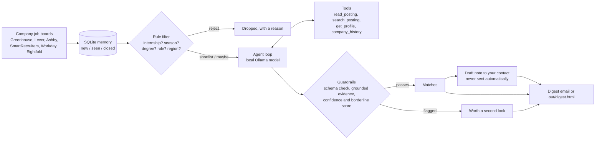

# Job Alert System v2: an agentic internship tracker

A local-first agent that watches company job boards, remembers what it has already seen, and
emails a short digest of internships that actually fit you. Each match comes with a fit score,
the reasons behind it, and which version of your resume to send.

It runs entirely on your machine with a local model through [Ollama](https://ollama.com).
No API keys, and your profile never leaves your computer.

## Why v2

v1 searched Google for phrases like "Python developer jobs in Irvine" and asked an LLM to
rewrite the results. That gave search-result pages instead of real postings, a relevance
score that only counted the search keywords, no memory between runs, and an LLM free to
rewrite links. v2 is rebuilt around one idea:

> **Deterministic first, AI only for judgment.** Cheap, explainable rules decide most
> postings. The LLM agent only sees what the rules could not settle, and everything it
> returns is validated before you see it.

## How it works



1. **Fetch** every company on `config/watchlist.yaml` through the job board's public JSON API.
   These are real postings with real links. If one board fails, it is reported in the
   digest and the rest of the run carries on.
2. **Remember.** SQLite tracks every posting. You only hear about new ones, plus postings
   you cared about that have since **closed**. Closing is only recorded when that company's
   board was fetched successfully, so an outage never looks like every job disappearing.
3. **Rule filter.** These checks run without an LLM: is it an internship (and not
   *Internal* Audit or *International* Payroll), the target season, open to master's
   students, an on-target role, and in Orange County, the Bay Area or remote US. Each
   check can pass, reject or say it can't tell. "Can't tell" sends the posting to the agent
   with a note, rather than throwing it away.
4. **Agent.** For each survivor, best first, a local model works through a tool loop. It
   reads the posting page by page, searches it for specific requirements, reads your
   profile, and checks other roles at the same company. It then submits a structured
   assessment:
   - `fit_score` (0–100)
   - `recommended_resume` (one of your resume versions)
   - `ai_forward` (does the role build with AI tools, or is it raw coding?)
   - `confidence`
   - `reasons` and `gaps`
   - `evidence` quoted from the posting
5. **Guardrails.**
   - Tool arguments are checked against a schema, and mistakes go back to the model so it
     can correct itself.
   - If the model never submits, one final call is made with Ollama's structured output,
     constrained to the schema.
   - Evidence quotes that don't appear in the posting are dropped.
   - Low confidence, a borderline score or ungrounded evidence moves the posting to
     **Worth a second look** instead of **Matches**.
   - There is a step limit per posting and a hard limit on model calls per run.
6. **Outreach.** For strong matches at a company where you have a friend, the agent drafts
   a short, informal note that asks for a quick call. It is only a draft and is never sent.
7. **Digest.** The digest is an HTML email with a plain-text version, and every value from
   the web is escaped. Use `--dry-run` to write it to `out/digest.html` instead.

## Setup

```bash
git clone https://github.com/OhmKulkarni/Job_Alert_System.git
cd Job_Alert_System
python -m venv .venv && source .venv/bin/activate   # Windows: .venv\Scripts\activate
pip install -r requirements.txt

# A local model with tool calling
ollama pull qwen2.5:7b

cp config/profile.example.yaml config/profile.yaml   # make it yours (git-ignored)
cp .env.example .env                                 # email settings (git-ignored)
```

Then check that every job board and the model respond:

```bash
python -m jobalert check
```

## Usage

```bash
python -m jobalert run --dry-run          # full run, digest saved to out/digest.html
python -m jobalert run                    # full run, digest emailed
python -m jobalert run --no-llm           # rules only (no Ollama needed)
python -m jobalert run --company paypal --limit 5
python -m jobalert list                   # assessed open postings, best first
python -m jobalert mark <id> applied      # applied | saved | ignored | new
```

The first run sees every posting as new, so it can take a while with a local model. The
agent assesses up to `max_postings_per_run` (25 by default), best first, and the rest
are assessed on later runs.

### Run it daily

The model is local, so the schedule runs on your own machine.

**macOS / Linux (cron):** run `crontab -e` and add:
```
0 8 * * * cd /path/to/Job_Alert_System && .venv/bin/python -m jobalert run >> out/cron.log 2>&1
```

**Windows (Task Scheduler):** create a daily task.
- Program: `C:\path\to\Job_Alert_System\.venv\Scripts\python.exe`
- Arguments: `-m jobalert run`
- Start in: `C:\path\to\Job_Alert_System`

## Configuration

| File | What it controls |
|---|---|
| `config/watchlist.yaml` | Companies and their job-board API (source + slug). Add a company in one line. |
| `config/settings.yaml` | Rule terms, target regions, model, agent budgets, review band |
| `config/profile.yaml` | You: summary, strengths, preferences, resume versions, contacts. **Git-ignored.** |
| `.env` | SMTP settings for the email digest. **Git-ignored.** |

To find a company's board, open their careers page and look at the URL:
- `job-boards.greenhouse.io/<slug>` → `greenhouse`
- `jobs.lever.co/<slug>` → `lever`
- `jobs.ashbyhq.com/<slug>` → `ashby`
- `jobs.smartrecruiters.com/<slug>` → `smartrecruiters`
- `<tenant>.wdN.myworkdayjobs.com/<site>` → `workday` (host + site)

## Project layout

```
jobalert/
  sources/      one adapter per job-board API, normalized to a Posting
  filters.py    deterministic rules (pass / reject / can't tell, with reasons)
  store.py      SQLite memory: postings, assessments, outreach drafts, runs
  llm.py        Ollama client (tools + structured outputs) and call budget
  agent/        tool definitions, agent loop, guardrails, prompts
  digest.py     HTML + text digest
  pipeline.py   one run, end to end
  cli.py        run / check / list / mark
tests/          69 tests; fakes for every board and the model (no network needed)
```

## Tests

```bash
pip install -r requirements-dev.txt
pytest
```

The tests cover:
- every job-board parser
- the rule filter, including real titles taken from live boards
- memory, including what happens when a source fails
- each agent guardrail: bad tool arguments, unknown tools, a forced final answer, invented
  evidence, review triggers and the call budget
- a full multi-run pipeline: new postings, then nothing new, then a posting closing
- HTML escaping and running with Ollama down

## Limits

- Workday and Eightfold boards are queried with a search term (`search_text`). That keeps
  the requests small, but it means they only find postings that match the term.
- Eightfold (PayPal) uses the career site's own search API, which is not a documented
  public API, so it may change.
- A 7–8B local model is much weaker than a frontier model. The guardrails are there so
  its mistakes end up in **Worth a second look** rather than in **Matches**.
